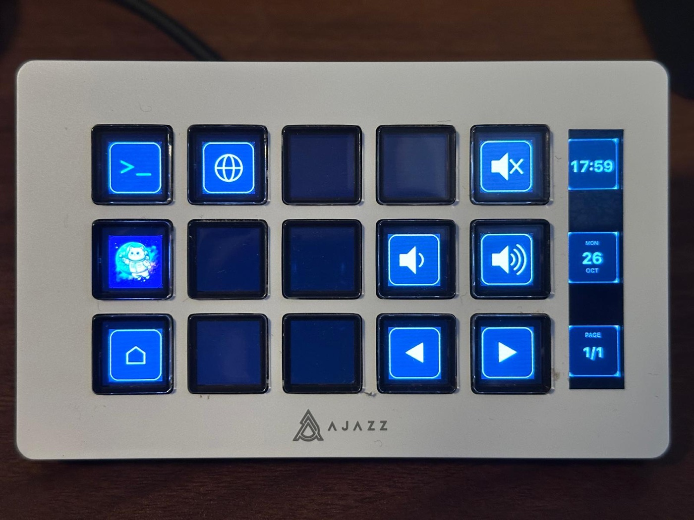
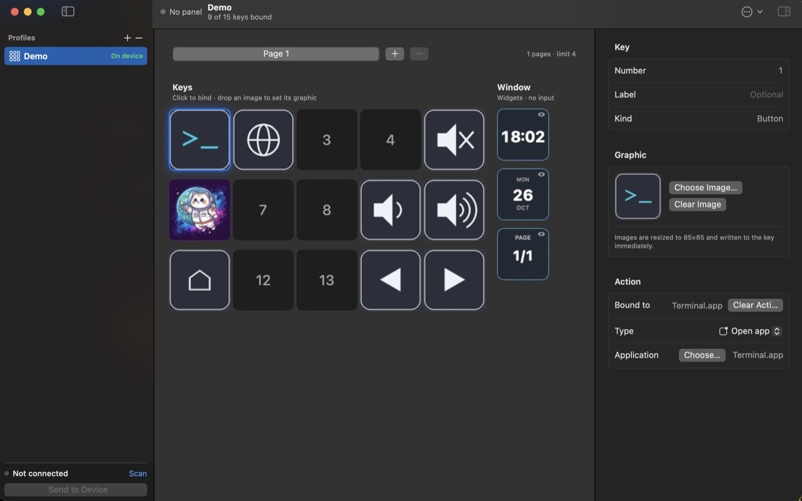
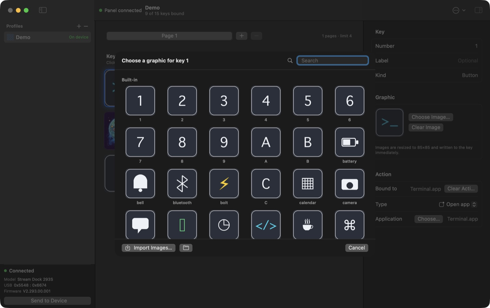
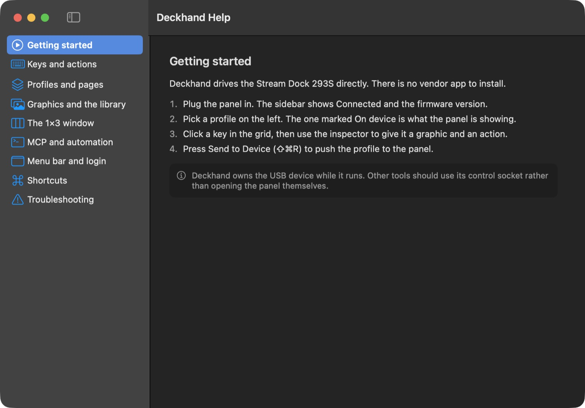

# Deckhand 0.1b (beta) for AJAZZ Stream Dock AKP153 (MacOS Only)

Made this for my own use, but decided to release this usable beta as opensource.

I used Hermes Agent (https://hermes-agent.nousresearch.com), REA: Reverse Engineer Anything (https://github.com/morluto/rea), and Orcarouter.Ai Deepseek-v4.1-flash-1017 (https://www.orcarouter.ai), and 8 hours of my time to get this first working beta.

This MacOS app was coded in Swift for the AJAZZ Stream Dock AKP153. You can build from source, or can used by notarized dmg release.

The vendor application is ~1.4 GB of Electron/CEF. Deckhand is 2.4 MB of Swift that talks to the panel
over IOKit, with no vendor binary loaded, shipped or required — the HID protocol was recovered by static
analysis of the vendor library and then verified against the hardware, byte for byte.

The original Driver/App is at https://ajazz.key123.vip/mac 

    app/          the macOS app (SwiftPM) + MCP server     → app/README.md
    docs/         the recovered wire protocol
    LICENSE       MIT
    README.md     this file

| the hardware | the app |
|---|---|
|  |  |

## What it does

* 15 keys + a 1×3 display window, 4 host-side pages per profile
* per-key graphics with an optional crop/rotate/zoom step, or use the file untouched
* bindings: key combination, open app, open URL, run script, page next / previous / first
* window panes render clock, date, CPU, memory, page number or custom text
* profiles saved as `.sdprofile`, **Save / Save As**, storage folders configurable in Settings
* follows the system language (Default is English)
* MCP server so an agent can drive it through the app's control socket

## Status — verified on the hardware

| area | state |
|---|---|
| display: 18 slots, images and window widgets | verified |
| physical presses, 15 keys, 350 ms debounce | verified |
| bindings (two keys launched two different apps) | verified |
| hot-plug unplug → "Not connected" → replug reconnect | verified |
| clearing a key, then Send to Device blanks it | verified |
| pages and page-navigation actions | verified |
| brightness · wake · commit · heartbeat | implemented from the decompile |

## Roadmap

Tracked as issues, in dependency order — each one needs the previous:

| # | step | issue |
|---|---|---|
| 1 | extract the stock firmware from our own units, with a verified way back | [#1](https://github.com/kruzif-x/deckhand/issues/1) |
| 2 | decode it: MCU, flash map, USB stack, image decoder, and the command handlers we already speak | [#2](https://github.com/kruzif-x/deckhand/issues/2) |
| 3 | improve the firmware and publish it: no wedge on bad writes, on-device pages, real window surface | [#3](https://github.com/kruzif-x/deckhand/issues/3) |
| 4 | let Deckhand flash firmware itself — verify, back up, recover | [#4](https://github.com/kruzif-x/deckhand/issues/4) |

Steps 1–2 are reverse engineering on hardware we own; step 3 is where the project stops describing
someone else's device and starts shipping its own.

## How the protocol was recovered

The vendor library (`libtransport.dylib`) is a few hundred KB that statically links hidapi and adds a
thin `transport_*` layer. Only the payload framing was actually unknown, so the work was:

1. `otool`/`nm` to see it links IOKit and exports all of hidapi — the USB plumbing was never the secret
   part.
2. Ghidra on the thinned arm64 slice for `Transport::setKeyImgFileStream`, `setKeyBrightness`,
   `heartbeat`, `changePage`, `wakeupScreen` and `TransportSession::transact`.
3. An lldb breakpoint on `IOHIDDeviceSetReport` in a harness that calls the vendor API, to capture the
   literal report bytes and confirm the decompiled reading.

Result (`docs/protocol-native.md`): an image is **two transmissions** — a 13-byte `CRT\0\0BAT` header
report, then the JPEG in **512-byte** reports — with `STP` to commit, `DIS` to wake, `CONNECT` as
keep-alive, and `M_V` + page to switch. The panel does not acknowledge writes; the vendor's own read
times out. Each of those three details was a bug that looked like "writes succeed, nothing appears", and
each is documented so it isn't rediscovered.

## Build

    cd app && ./build.sh
    open Deckhand.app

macOS 14+, Xcode command line tools, arm64. While Deckhand runs it owns the HID device; other tools
should use its control socket (`~/Library/Application Support/Deckhand/control.sock`) or the MCP server.

## Icon and built-in graphics

Both are generated from code, so the assets are original and reproducible:

    python3 tools/make_icon.py app/Resources/AppIcon.icns cyan     # squircle keypad + 1×3 display strip
    python3 tools/make_library.py app/Resources/Library             # 78 key graphics

`make_icon.py` takes `cyan`, `mint` or `indigo` as the accent.

## Licence

MIT (`LICENSE`). No vendor code is included: the vendored SDK used as a reference oracle during
development has been deleted from the tree, and the driver is a fresh implementation of the observed
protocol. The vendor binary itself was never redistributed.
